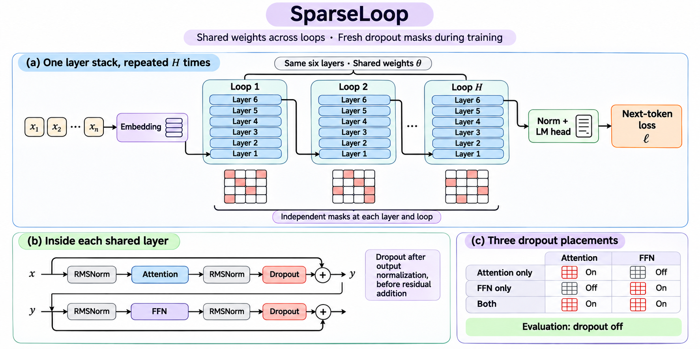

<h1 align="center">Loop Transformer</h1>

<p align="center"><strong>Where does dropout help a language model that reuses its layers?</strong></p>

<p align="center">
  <a href="LICENSE"></a>
  
</p>



**SparseLoop** studies how dropout affects a language model that reuses its layers. We apply dropout to the attention output, the feed-forward network (FFN) output, or both, then measure prediction quality and the behavior of each layer.

The model has six physical layers, regardless of the number of loops. Each loop reuses their weights. During training, enabled branches draw fresh dropout masks after output normalization and before residual addition. Evaluation uses the full dense model with dropout off.

## Installation

Use Python 3.10 or newer. Install a PyTorch build that supports your GPU before running CUDA training; the experiments used PyTorch 2.4.0 and BF16 on H100/H200.

```bash
git clone https://github.com/Hik289/loop-transformer.git
cd loop-transformer
python -m venv .venv
source .venv/bin/activate
pip install -e ".[data,plots,dev]"
```

## Quick start

First run a tiny CPU check. It uses synthetic tokens, verifies an exact 257-token budget, and removes its temporary files when finished.

```bash
python scripts/smoke_test.py
python -m pytest tests/test_sparsedrop_model.py tests/test_sparsedrop_training.py -q
```

## Run the experiments

Prepare FineWeb-Edu tokens once. The full training array contains 20B + 1 tokens: the extra token supplies the last next-token label. The training array alone occupies about 40GB before NumPy headers; downloads and temporary shards need additional space.

```bash
source cluster/env.sh
python scripts/prepare_fineweb_sparsedrop.py \
  --output-dir data/fineweb_edu20b --workers 8
```

Train one small-model condition from the repository root:

```bash
python scripts/train_sparsedrop.py \
  --config configs/sparsedrop_long/003_h4_ffn_p0.10_constant_d0.00_s42.json
```

Train one 400M condition:

```bash
python scripts/train_sparsedrop.py \
  --config configs/sparsedrop_400m20b/000_m404m_h2_ffn_p0.10_s42.json
```

The small-model configuration stops at **100,000 steps / 1.6384B tokens**. The 400M configuration runs to **20B tokens / 1,220,704 steps**. Both compute next-token loss after the final loop. See [settings and budgets](docs/EXPERIMENTS.md) before launching a full grid.

## Citation

If you use this code, please cite the repository:

```bibtex
@software{looptransformer2026,
  title = {Loop Transformer: Dropout in Shared-Weight Language Models},
  year = {2026},
  url = {https://github.com/Hik289/loop-transformer},
  version = {0.1.0}
}
```
