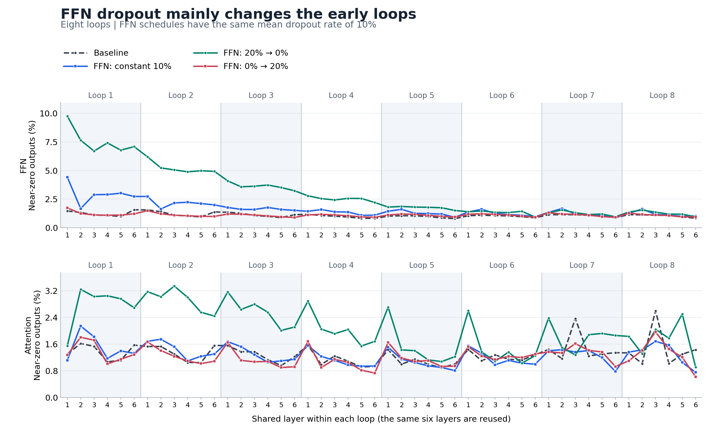
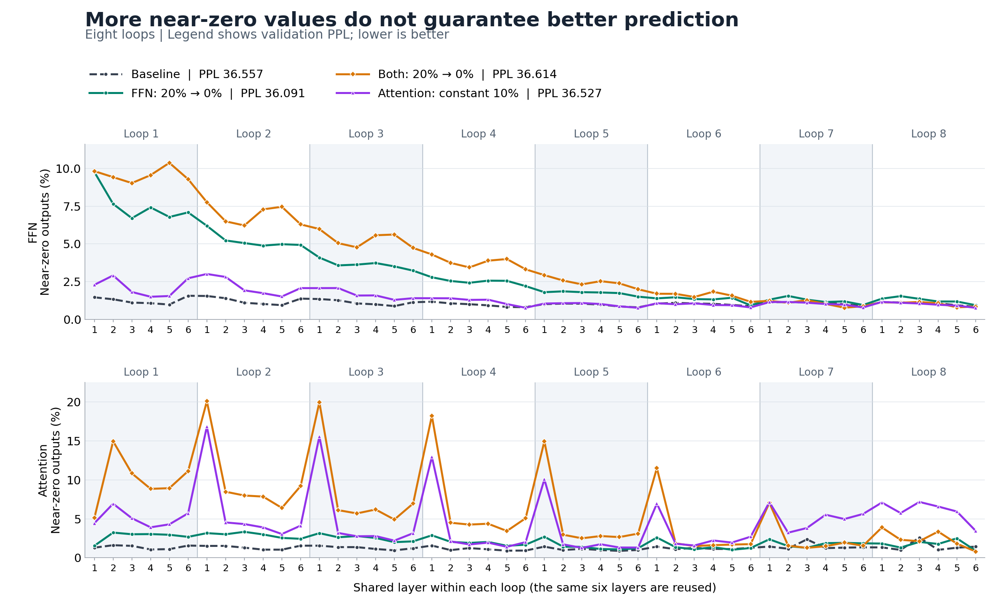
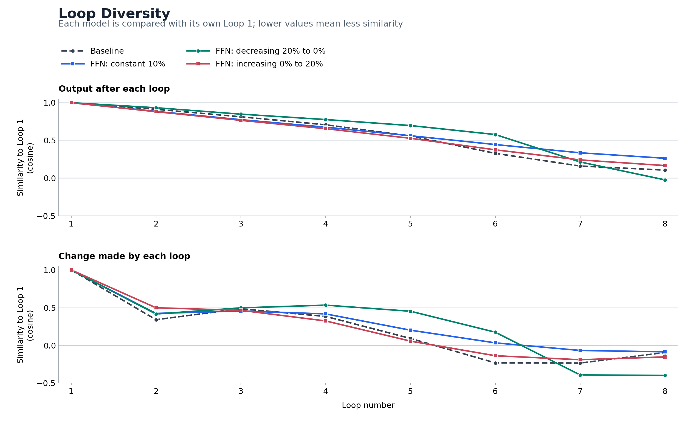
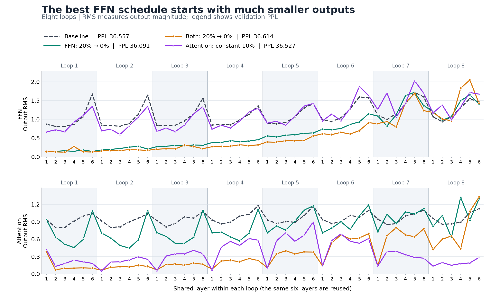
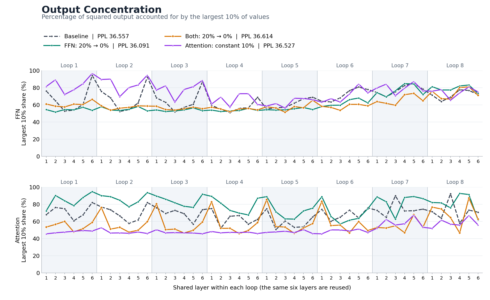

# Recorded results

The small-model tables use the same 100,000-step checkpoint, 1.6384B training tokens, seed 42, and fixed 128 validation chunks for every row. The repository includes the underlying evaluation record for all 52 settings. A historically longer run contributes its saved 100k record, not its later endpoint.

Near-zero percentages are averages across all layer uses in the named branch, with threshold 0.01. Measurements use the same 512 fixed tokens with dropout off. See [measurement definitions](METHOD.md).

## Fixed-rate dropout: 80M model

Bold loss and PPL values are the best within a loop count. Small differences come from one seed and have no cross-seed uncertainty estimate.

| Loops | Placement | Dropout p | Loss | PPL | FFN near-zero (%) | Attention near-zero (%) |
| --- | --- | --- | --- | --- | --- | --- |
| 1 | Baseline | 0.00 | 3.661180 | 38.907221 | 1.438 | 1.946 |
| 1 | FFN | 0.05 | **3.658441** | **38.800813** | 1.750 | 1.808 |
| 1 | Attention | 0.05 | 3.665458 | 39.074011 | 1.406 | 2.438 |
| 1 | Both | 0.05 | 3.661153 | 38.906174 | 1.530 | 2.029 |
| 1 | FFN | 0.10 | 3.659046 | 38.824279 | 1.990 | 1.673 |
| 1 | Attention | 0.10 | 3.669450 | 39.230329 | 1.398 | 2.860 |
| 1 | Both | 0.10 | 3.669939 | 39.249528 | 1.519 | 1.908 |
| 1 | FFN | 0.20 | 3.659837 | 38.855027 | 2.789 | 1.636 |
| 1 | Attention | 0.20 | 3.682578 | 39.748723 | 1.456 | 3.911 |
| 1 | Both | 0.20 | 3.706490 | 40.710657 | 1.507 | 1.774 |
| 2 | Baseline | 0.00 | 3.637858 | 38.010321 | 1.256 | 1.589 |
| 2 | FFN | 0.05 | 3.632906 | 37.822579 | 1.740 | 1.834 |
| 2 | Attention | 0.05 | 3.637134 | 37.982812 | 1.459 | 2.757 |
| 2 | Both | 0.05 | 3.638768 | 38.044939 | 1.664 | 2.367 |
| 2 | FFN | 0.10 | **3.629155** | **37.680979** | 2.068 | 1.887 |
| 2 | Attention | 0.10 | 3.648652 | 38.422848 | 1.520 | 3.168 |
| 2 | Both | 0.10 | 3.634937 | 37.899466 | 1.755 | 2.423 |
| 2 | FFN | 0.20 | 3.632830 | 37.819683 | 2.681 | 1.918 |
| 2 | Attention | 0.20 | 3.647405 | 38.374959 | 1.576 | 3.915 |
| 2 | Both | 0.20 | 3.658715 | 38.811436 | 1.687 | 2.304 |
| 4 | Baseline | 0.00 | 3.611469 | 37.020392 | 1.232 | 1.661 |
| 4 | FFN | 0.05 | 3.602520 | 36.690571 | 1.760 | 1.842 |
| 4 | Attention | 0.05 | 3.607137 | 36.860363 | 1.590 | 3.742 |
| 4 | Both | 0.05 | 3.604487 | 36.762836 | 1.883 | 3.213 |
| 4 | FFN | 0.10 | 3.600985 | 36.634312 | 2.010 | 1.802 |
| 4 | Attention | 0.10 | 3.615326 | 37.163474 | 1.638 | 4.363 |
| 4 | Both | 0.10 | 3.603525 | 36.727484 | 2.010 | 3.078 |
| 4 | FFN | 0.20 | **3.600669** | **36.622721** | 2.697 | 1.963 |
| 4 | Attention | 0.20 | 3.626367 | 37.576071 | 1.519 | 4.554 |
| 4 | Both | 0.20 | 3.623393 | 37.464467 | 1.963 | 2.924 |
| 8 | Baseline | 0.00 | 3.598867 | 36.556802 | 1.078 | 1.293 |
| 8 | FFN | 0.05 | 3.600792 | 36.627225 | 1.491 | 1.391 |
| 8 | Attention | 0.05 | **3.593530** | **36.362223** | 1.153 | 3.824 |
| 8 | Both | 0.05 | 3.595758 | 36.443325 | 1.680 | 3.324 |
| 8 | FFN | 0.10 | 3.594225 | 36.387473 | 1.621 | 1.270 |
| 8 | Attention | 0.10 | 3.598052 | 36.527012 | 1.393 | 4.584 |
| 8 | Both | 0.10 | 3.599282 | 36.571975 | 1.943 | 3.475 |
| 8 | FFN | 0.20 | 3.597885 | 36.520922 | 2.171 | 1.532 |
| 8 | Attention | 0.20 | 3.605918 | 36.815462 | 1.269 | 4.438 |
| 8 | Both | 0.20 | 3.607120 | 36.859738 | 1.804 | 3.102 |

## Dropout across eight loops: 80M model

Every schedule below has mean dropout 0.10. The endpoints give the rates in Loop 1 and Loop 8. The three constant settings above serve as controls.

| Placement | Schedule | First / last loop rate | Loss | PPL | FFN near-zero (%) | Attention near-zero (%) |
| --- | --- | --- | --- | --- | --- | --- |
| Attention | Decreasing | 0.15 / 0.05 | 3.601670 | 36.659404 | 1.305 | 4.116 |
| Attention | Decreasing | 0.20 / 0.00 | 3.607355 | 36.868421 | 1.581 | 4.529 |
| Attention | Increasing | 0.05 / 0.15 | 3.598941 | 36.559481 | 1.145 | 4.132 |
| Attention | Increasing | 0.00 / 0.20 | 3.600277 | 36.608380 | 1.068 | 4.030 |
| Both | Decreasing | 0.15 / 0.05 | 3.597269 | 36.498425 | 2.612 | 4.283 |
| Both | Decreasing | 0.20 / 0.00 | 3.600422 | 36.613690 | 3.958 | 5.994 |
| Both | Increasing | 0.05 / 0.15 | 3.597782 | 36.517133 | 1.468 | 2.944 |
| Both | Increasing | 0.00 / 0.20 | 3.607512 | 36.874179 | 1.073 | 2.587 |
| FFN | Decreasing | 0.15 / 0.05 | 3.588062 | 36.163937 | 2.157 | 1.559 |
| FFN | Decreasing | 0.20 / 0.00 | 3.586046 | 36.091071 | 3.062 | 2.090 |
| FFN | Increasing | 0.05 / 0.15 | 3.599516 | 36.580520 | 1.413 | 1.302 |
| FFN | Increasing | 0.00 / 0.20 | 3.604350 | 36.757789 | 1.108 | 1.234 |

## What the layer plots show

With eight loops, FFN dropout decreasing from 20% to zero raises the first-loop mean near-zero fraction to 7.57%, while the last-loop value is 1.26%. The baseline changes from 1.25% to 1.03%. The effect is concentrated in early uses of the shared layers.

Applying the decreasing schedule to both branches creates a larger first-loop FFN near-zero fraction, 9.58%, but worse PPL: 36.614 versus 36.091 for FFN-only dropout. Counting more small outputs would choose the worse of these two models.

Loop similarity is measured against Loop 1 of the same model. The decreasing FFN schedule keeps loop outputs closer to the first loop for longer, then changes more strongly near the end. This describes the learned computation; it does not by itself prove error correction.

Output size and the share carried by the largest values help explain the near-zero counts. A branch can have more near-zero outputs because its whole output becomes smaller, even when its largest values account for a smaller share.

## Completed 400M / 20B results

Snapshot: November 7, 2026. One of 18 runs has completed. Only finished runs appear below. Each uses 20B training tokens and the complete 2,048-chunk validation set. These scores use a different validation scope from the small-model tables.

| Loops | Placement | Dropout p | Training tokens B | Loss | PPL | FFN near-zero (%) | Attention near-zero (%) | Mean update cosine |
| --- | --- | --- | --- | --- | --- | --- | --- | --- |
| 2 | Attention | 0.10 | 20.0000 | 2.907877 | 18.317870 | 7.8436 | 18.0922 | 0.085726 |

## Limits of the comparison

The 80M study uses a single seed and an early stop on a longer learning-rate schedule. Validation also guided the choice of settings. More loops use more compute at the same token budget. The layer sample has 512 tokens, and near-zero outputs do not establish safe pruning. The 400M study is still incomplete; its first result does not yet compare dropout placements.
